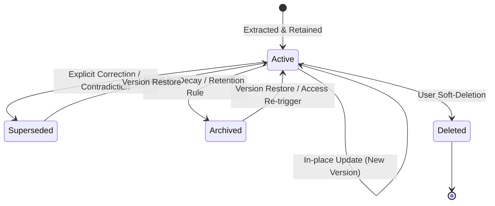

# MEMOS — System Architecture & Design
**Memory Evolution and Management for Organized Semantic Storage**

---

## 1. Executive Summary

MEMOS is an integrated conversational AI memory system designed to solve the long-term context retention problem in modern Large Language Models (LLMs). Rather than stuffing extensive history into LLM context windows or relying solely on naïve nearest-neighbor vector search, MEMOS implements a **multi-store hybrid architecture**:

1. **Document Store (MongoDB)**: Canonical memory truth, document versions, conversation threads, and relational entity metadata.
2. **Dense Vector Store (ChromaDB)**: High-dimensional semantic embeddings (`sentence-transformers/all-MiniLM-L6-v2`, 384 dimensions) for semantic similarity retrieval.
3. **Graph Store (Neo4j)**: Entity-relation-entity knowledge graph for multi-hop associative queries and structured entity tracking.
4. **Hybrid Retrieval**: Reciprocal Rank Fusion (RRF) unifying vector similarity and graph connectivity into a unified ranking formula.
5. **Memory Evolution Engine**: Automatic extraction, deduplication, conflict resolution, explicit correction, and immutable versioning.

---

## 2. High-Level Architecture

```
                          ┌──────────────────────────────────────┐
                          │     React / Vite Web Application     │
                          │   (Chat, Memory Graph, Timeline, UI) │
                          └──────────────────┬───────────────────┘
                                             │ HTTP / REST
                                             ▼
                          ┌──────────────────────────────────────┐
                          │         FastAPI Backend Core         │
                          │        (Asynchronous Python)         │
                          └──────┬───────────┬───────────┬───────┘
                                 │           │           │
                 ┌───────────────┘           │           └───────────────┐
                 ▼                           ▼                           ▼
      ┌────────────────────┐      ┌────────────────────┐      ┌────────────────────┐
      │   MongoDB Store    │      │  ChromaDB Vector   │      │   Neo4j Graph      │
      │ Canonical Memories │      │  384-d Embeddings  │      │ Entity-Relation    │
      │ Version History    │      │  Cosine / HNSW     │      │ Multi-Hop Traversal│
      │ Conversations      │      │                    │      │                    │
      └────────────────────┘      └────────────────────┘      └────────────────────┘
```

---

## 3. Data Storage Model

### 3.1 MongoDB Collections
- `memories`: Stores canonical memory items with status (`active`, `superseded`, `archived`, `deleted`), category (`preference`, `fact`, `project`, `goal`, `constraint`, `relationship`, `temporal`, `general`), importance, confidence, and cross-references.
- `memory_versions`: Append-only immutable log of every memory modification, action (`created`, `updated`, `superseded`, `archived`, `restored`, `deleted`), and change rationale.
- `conversations`: Conversation sessions with message count and timestamps.
- `messages`: Individual chat turns with roles (`user`, `assistant`), processing latency, and `memory_ids_used`.
- `users`: User profiles and settings.

### 3.2 ChromaDB Collections
- `memos_embeddings`: Vector store indexed by `memory_id` storing dense embeddings calculated using `all-MiniLM-L6-v2`. Metadata filters allow querying exclusively across `status == "active"` and `user_id == current_user`.

### 3.3 Neo4j Knowledge Graph
- Nodes:
  - `(:Entity {name, type, user_id})`
  - `(:Memory {memory_id, content, user_id})`
- Relationships:
  - `(:Entity)-[:RELATION {type, weight}]->(:Entity)`
  - `(:Memory)-[:MENTIONS]->(:Entity)`

---

## 4. Memory Evolution Engine & State Machine

Every memory transitions across states governed by an immutable state machine:



### 4.1 Lifecycle States
- **ACTIVE**: In standard retrieval rotation. Vector and graph indices populated.
- **SUPERSEDED**: Replaced by newer or contradictory fact. Excluded from standard retrieval, but preserved in version history.
- **ARCHIVED**: Decayed through age or low access frequency. Kept for historical reference.
- **DELETED**: Soft-deleted by user request. Removed from vector indices immediately.

### 4.2 Conflict Resolution
When a new memory candidate is processed:
1. Candidate embedding is compared to existing active memories.
2. If semantic similarity exceeds threshold (>0.85):
   - **Contradiction Check**: Evaluates if the new candidate directly opposes existing facts (e.g., "likes dark mode" vs "hates dark mode").
   - **Update Check**: Newer fact supersedes old fact; old fact transitioned to `SUPERSEDED`, bidirectional links recorded (`supersedes_memory_id`, `superseded_by_memory_id`).
   - **Duplicate Check**: If candidate conveys identical information, the access count and confidence of existing memory are boosted rather than creating duplicate entries.

---

## 5. Retrieval Pipeline & Reciprocal Rank Fusion (RRF)

When a user query arrives, MEMOS executes dual retrieval paths:

1. **Semantic Search (Vector)**:
   - Queries ChromaDB with query embedding.
   - Retrieves top-$K$ nearest neighbors based on cosine similarity.
   - Yields ranked list $R_{vec}$.

2. **Graph Traversal (Entity Associative)**:
   - Identifies named entities in the query.
   - Traverses $1$-to-$2$ hops in the Neo4j graph to find co-occurring entities and linked memories.
   - Yields ranked list $R_{graph}$.

3. **Reciprocal Rank Fusion (RRF)**:
   For every memory candidate $d \in R_{vec} \cup R_{graph}$:
   $$RRF(d) = \sum_{m \in \{vec, graph\}} \frac{I(d \in R_m)}{k + rank_m(d)}$$
   where $k=60$ by default.

4. **Context Injection**:
   The top fused memories are formatted into a structured prompt context block injected into the LLM system prompt:
   ```markdown
   [RELEVANT MEMORIES]
   - Preference: User prefers Python for backend development (Importance: 0.90)
   - Fact: User works on MEMOS project (Importance: 0.85)
   ```

---

## 6. Security, Isolation, and Extensibility

- **User Isolation**: All database queries, vector lookups, and graph traversals enforce strict tenancy boundaries via `user_id`.
- **Pluggable LLM Providers**: Backend abstracts LLM calls through `BaseLLMProvider`, providing native Ollama support with graceful offline fallback.
- **Degraded Operation**: If Neo4j or Ollama is offline, the backend gracefully degrades to pure vector or rule-based processing without downtime.
